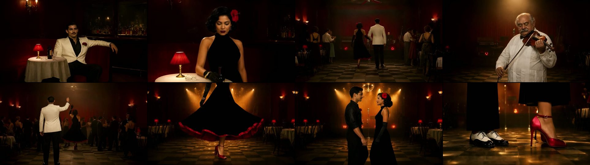
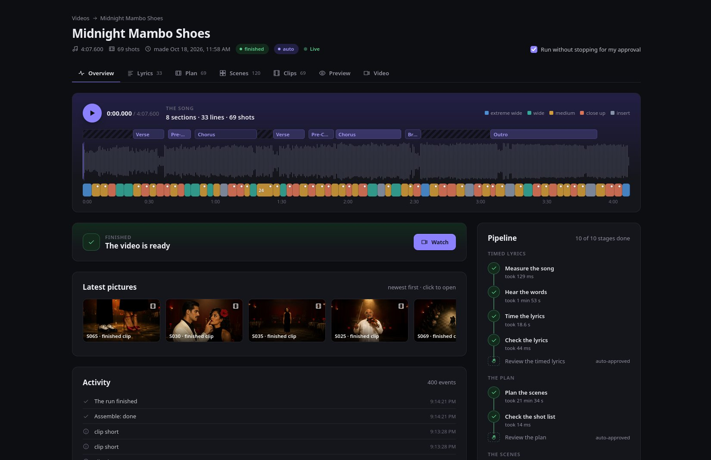
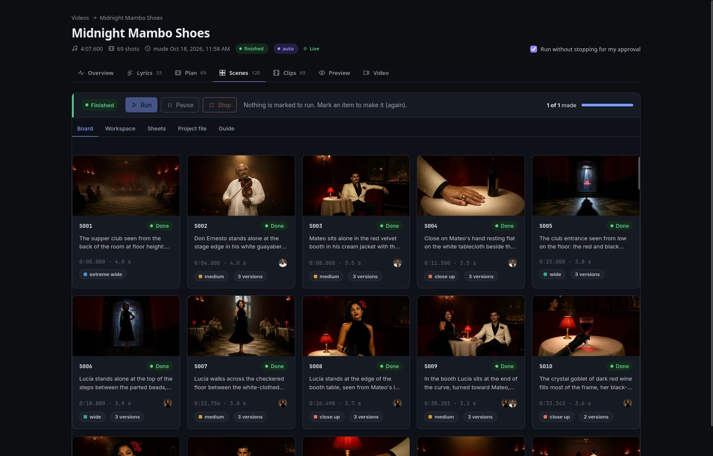
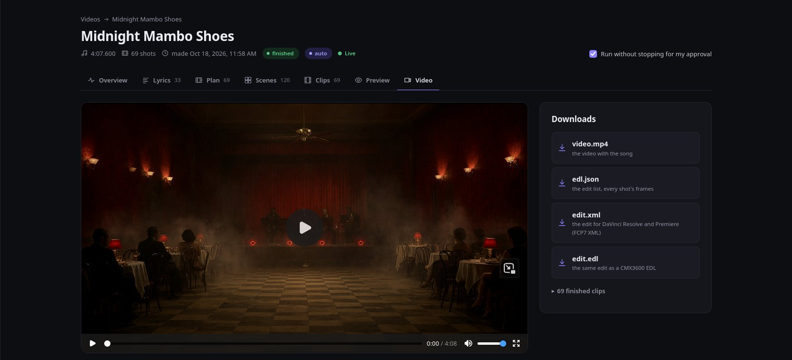

# hone-music-video


**Song in, music video out.** Give it a song (and, if you have them, its lyrics, its characters' sheets
and the look you want). hone-music-video times every line to the millisecond, plans the story, every shot
and every picture's prompt with a strong hosted model, writes them as a Hone Frame project file, draws
the characters, objects, places and scenes on local models the way Hone Frame does, turns each scene into
a clip, then cuts the clips to the exact timeline under the song. A web dashboard takes the song and
shows every stage as it happens.

Part of **[honeworks](https://github.com/honeworks)**: small, standalone tools for reliable generative-AI
workflows. Built on [hone-flow](https://github.com/honeworks/hone-flow) (runs you can resume) and
[hone-models](https://github.com/honeworks/hone-models) (one layer for local and hosted models).

> **Status: 0.1 built, not released yet.** Every stage runs: timed lyrics, the plan, the scenes (Hone
> Frame's workspace, changes 0027 to 0033, experimental), clips, finishing and the assembly, with the
> dashboard. The design is in [design/current.md](design/current.md); its record is
> [design/changes/0001](design/changes/0001-initial-design.md). A guide per stage is in [docs/](docs/).

## Made with it: *Midnight Mambo Shoes*



A 4-minute English song, a smoky nightclub, two dancers and a pair of red shoes. From the song, its
lyrics and a short story, hone-music-video timed 33 lines, planned 69 shots against the song's shape,
drew the cast, the club and every scene, animated each one and cut them to the millisecond under the
song: **$2.28 of hosted calls** (the plan $2.18, the lyrics $0.11) and **7.5 hours on an 8 GB laptop
GPU** (scenes 2.7 h, clips 3.5 h, finishing 1.3 h).

## The dashboard

Everything happens in a local web page: drop the song, approve (or let it run on its own), and watch
each stage land.

**Overview**: the song's sections and every shot on its timeline, the stages as they run, the latest
pictures and clips.



**Scenes**: every scene's picture as it is drawn, its time, framing, cast and versions; open one to edit
its prompts, run it again or use another version.



**Video**: the finished video, its edit list and the edit for DaVinci Resolve and Premiere; below them, what it cost.



## What it does

1. **Timed lyrics:** Whisper word times plus one call to a strong LLM that fixes the words, lines and
   sections; every time comes from the audio and is checked by code ([docs/lyrics.md](docs/lyrics.md)).
2. **The plan:** feeling first. The song's shape is measured from the audio (drops, quiet parts, the
   voice, how fast it is sung) and read with the lyrics' notes and what you say the viewer should feel;
   then several calls to a strong LLM: the story (what the viewer should feel, part by part; the
   characters, objects, places and their looks), the shot list on the song's timeline (each shot's
   feeling and what shows it, read again by a reviewer), one call per character, object and place for its
   pictures' prompts, and one per six scenes; the code checks every prompt against the written limits
   of the local models and asks for repairs. The result is a Hone Frame project file, the source of
   truth for every picture ([docs/shots.md](docs/shots.md)).
3. **The scenes:** made the Hone Frame way, in file order: the demo pictures first (held for you), then
   each character's hero picture and views, the objects, the places, every scene from their pictures.
   Each item can be edited (the file is written back keeping its comments), marked to run again, picked
   from several, or replaced with your own picture; every version is kept ([docs/cast.md](docs/cast.md)).
4. **Clips, finish:** each scene's picture in use is the start frame; Wan 2.2 animates it, Real-ESRGAN
   and RIFE make it 1080p at 32 fps ([docs/render.md](docs/render.md)). A scene changed later remakes
   only its clip.
5. **Assembly:** every clip cut to its frames from the absolute times (each cut within half a frame of
   its time, the video as long as the song to one frame), under the song, with an edit list
   ([docs/assembly.md](docs/assembly.md)).

You approve the timed lyrics, the plan and the scenes before the clips run (or tick "Run without stopping
for my approval" and it goes to the end on its own). A hard scene gets two or three prompts: the first is
drawn and animated, and **Run prompt N** draws another when you want to compare; use it, and only that
shot's clip and the cut are made again.

**A night of videos.** Tick "Prepare only" for each song: the steps that need the internet (the lyrics,
the plan) run and it waits. Then **Run all prepared** on the Videos page makes every prepared video one
after another, offline, without stopping; a stopped dashboard picks its queue up when started again.

## Install

Python 3.11 or newer and **ffmpeg** (with ffprobe) on the path. Not on PyPI yet; from a clone:

```text
gh repo clone honeworks/hone-music-videos && cd hone-music-videos
uv sync                                    # hone-flow and hone-models come from GitHub
uv run hone-music-video --help
```

For real runs:

- **Hosted models** (word times, the lyrics editor and the planner) go through an OpenAI-compatible gateway: put
  `OPENAI_COMPATIBLE_API_KEY=...` in the environment or in a `.env` file in the folder you run from (never commit it).
- **Local models** run on [ComfyUI](https://github.com/comfyanonymous/ComfyUI) with an NVIDIA GPU of 8 GB
  or more: Qwen-Image 2.1 Turbo (the scenes' default image model), Wan 2.2 I2V 14B (fp8, 4-step LoRA),
  Real-ESRGAN x2 and RIFE 4.9. Set `HONE_COMFYUI_START` to the command that starts ComfyUI (each
  stage starts and stops it). The clips stage starts ComfyUI with `--use-sage-attention`, which needs
  SageAttention 2.2 in ComfyUI's Python (a prebuilt wheel matching its torch and CUDA works too; the
  rollback is `sageattention==1.0.6`):

  ```bash
  git clone https://github.com/thu-ml/SageAttention ~/build/SageAttention && cd ~/build/SageAttention
  sed -i 's/-std=c++17/-std=c++20/g' setup.py          # torch 2.9 and later need C++20
  export TORCH_CUDA_ARCH_LIST="8.9"                     # your GPU's architecture (8.9: RTX 40xx)
  uv build --wheel --no-build-isolation --python ~/ComfyUI/.venv/bin/python
  uv pip install --python ~/ComfyUI/.venv/bin/python --no-deps dist/sageattention-2.2.0-*.whl
  ```

  Set `HONE_COMFYUI_PYTHON=~/ComfyUI/.venv/bin/python` so each clip's record shows the version. Details
  in [docs/render.md](docs/render.md).
- **The vocals** of the song are isolated once by Demucs (`htdemucs`) on the CPU (about 90 s for a
  five-minute song, kept in the project), and the transcriber hears them instead of the mix; lines it
  still did not hear are listened for again in their slices of the mix and of the vocals. That needs
  the optional extra `separate` (torch and demucs): `uv sync --extra separate`, or
  `pip install "hone-music-video[separate]" --extra-index-url https://download.pytorch.org/whl/cpu`
  (torch's smaller CPU build, all it uses). Its weights (about 80 MB) download on first use to the
  Hugging Face cache (`~/.cache/huggingface/hub`, or `$HF_HOME`). Without it the transcriber hears the
  mix and the lyrics report says so. Details in [docs/lyrics.md](docs/lyrics.md).
- **Your lyrics are aligned** to those vocals by Meta's MMS forced aligner (torchaudio's `MMS_FA`) on
  the CPU (about a minute for a five-minute song): every given line is placed, every word timed from the
  singing, and the transcriber's words become the cross-check. That needs the optional extra `align`
  (torch, torchaudio, uroman): `uv sync --extra align`, or `pip install "hone-music-video[align]"
  --extra-index-url https://download.pytorch.org/whl/cpu`. Its weights (about 1.2 GB) download on first
  use to torch's cache (`~/.cache/torch/hub`, or `$TORCH_HOME`). Without it, or with `models.align` set
  to `null`, the lines are timed from the transcriber's words as before.

## Quickstart (fake models, a few seconds)

Fake models answer every call (no network, no GPU), so you can see the whole flow and the files it
leaves; the assembly is the real one.

```python
import tempfile
from pathlib import Path

import hone_music_video as hmv
from hone_music_video.testing import FakeModels, make_song, settle_scenes

folder = Path(tempfile.mkdtemp())
song = make_song(folder / "song.wav", 12_000)  # 12 s of silence stands in for a song
lyrics = hmv.Material(lyrics="she waits upon the balcony\nthe wind is in her hair")
project = hmv.create_project(folder / "projects", "Balcony", song, lyrics)
state = hmv.start(project, FakeModels())  # runs to the first gate
while state.waiting:  # review_lyrics, review_plan, review_scenes
    if state.waiting == "review_scenes":
        settle_scenes(project, FakeModels())  # what you do in the Scenes view: accept, pick, run
    hmv.approve(project)
    state = hmv.resume(project, FakeModels())
print(state.status, project.current / "video.mp4")
```

Or the dashboard: `hone-music-video dashboard --fake-models`, open http://127.0.0.1:8794/, **New video**,
then **Approve** at each gate. More in [examples/](examples/).

## A real run

```text
hone-music-video dashboard                         # http://127.0.0.1:8794/ : New video, Start
```

or from the command line:

```text
hone-music-video new "My song" --song song.mp3 --lyrics lyrics.txt --sheet "Darvin=darvin.png:the hero"
hone-music-video run projects/my-song              # measure, transcribe, lyrics, check_lyrics
hone-music-video approve projects/my-song          # gate 1: the timed lyrics (or reject --note "...")
hone-music-video resume projects/my-song           # the plan: story, shots, prompts, the project file
hone-music-video approve projects/my-song          # gate 2: the plan (check-shots lists it)
hone-music-video resume projects/my-song           # the scenes: demo pictures first, then every item
hone-music-video frame status projects/my-song     # what waits for you: accept, pick, edit, run (Hone Frame)
hone-music-video approve projects/my-song          # gate 3: the scenes as they are
hone-music-video resume projects/my-song           # clips, finishing, assembly: hours
hone-music-video redo projects/my-song S004        # a new clip seed for any shot; then:
hone-music-video remake projects/my-song           # only the changed shots' clips, and the cut
```

**Hear when it needs you.** Set `HONE_MV_NOTIFY_URL` (a Slack, Mattermost or Discord webhook, a
Telegram bot's `sendMessage` URL with `HONE_MV_NOTIFY_KIND=telegram`, or any HTTP endpoint) in the
environment or `.env`, and the run sends a message when a gate waits for you, a stage fails and the
video is done, with a link to the project's page ([docs/operations.md](docs/operations.md)).
`hone-music-video costs projects/my-song` says what the video cost (hosted calls, GPU hours), and the
Video view offers the edit for DaVinci Resolve and Premiere (`edit.xml`, `edit.edl`).

A run stopped at any point (a crash, Ctrl-C, a reboot) continues with `resume`, keeping every finished
stage and shot. Every command is in [docs/cli.md](docs/cli.md), every setting in
[docs/settings.md](docs/settings.md), and what to do when a stage stops in
[docs/troubleshooting.md](docs/troubleshooting.md).

**Costs and times** (design §15): the timed lyrics cost a few cents, the plan about a dollar for a
five-minute song (several calls). On an 8 GB laptop GPU (RTX 4060) a picture takes about a minute and a
5-second clip about 4 (the finish about 1.5), about 6 with faces; a five-minute
song is about 8 hours, unattended after the scenes gate. The assembly of a five-minute video takes about
77 s on the CPU (measured on an i9-14900HX, 32 threads; fewer cores take longer).

**A sample to look at.** `scripts/sample-project.py` makes a project from the sample song in
`samples/The Long Night/` (kept out of the repository) and the trial's real pictures and clips in
`../pipeline-demo`, runs it through the real workflow on a sample model set and assembles the video
(`--live` serves the dashboard and stops at each gate).

## How this is being built

Specified by a human; designed and built by AI against a written design and tests; every decision is
reviewed by a human. The design history is in [design/changes/](design/changes/) and
[design/decisions.md](design/decisions.md); the evidence behind the choices is in
[design/history/0000-research.md](design/history/0000-research.md).

## License

Apache-2.0.
